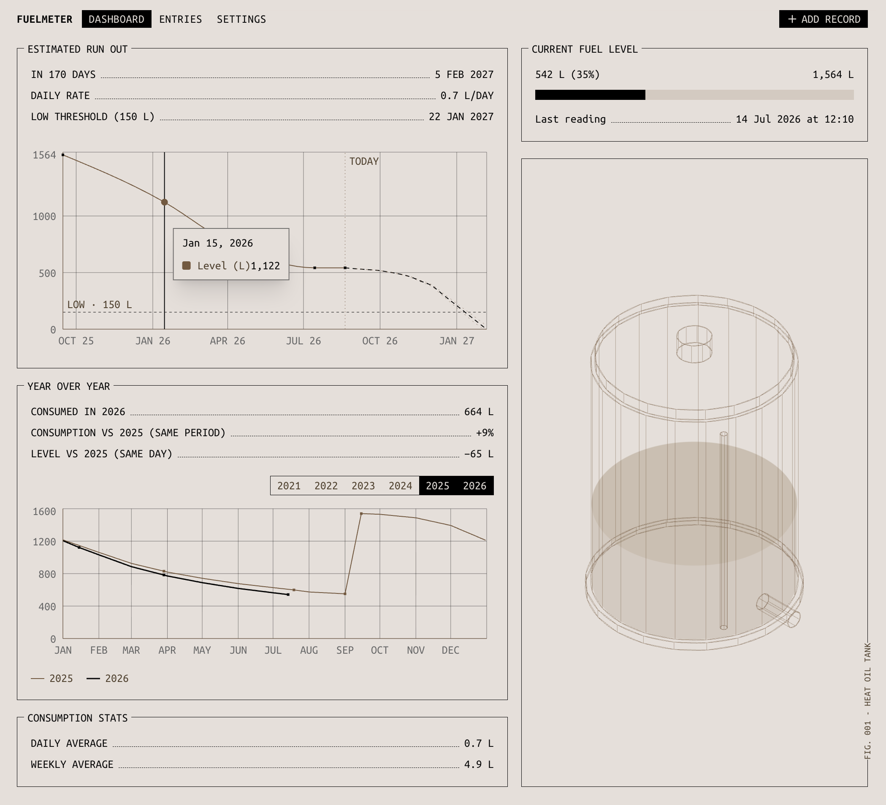

# Fuelmeter

Know how much diesel is left in the tank, and when it'll run out.



## Problem space

Up in the mountains I heat the house and the water with a diesel tank, and the
tank has no gauge. You check it with a dip-stick, get a reading in centimetres,
and then guess whether you'll make it through winter.

So I built Fuelmeter. I log the reading, it converts to litres off the
manufacturer's calibration table, and it tells me roughly when I'll run out. The
bit I'm weirdly proud of is the forecast: a flat rate lies, because I burn way
more in January than in May, so it learns the seasonal pattern from my own
history instead of averaging.

It's deeply boring to anyone but me, and I check it constantly.

## What it does

You log a dip-stick reading in centimetres and mark it as a refill if it was one.
Everything else is derived from that.

- Centimetres become litres against the manufacturer's calibration table
  (`lib/tank-lookup.ts`, 1 to 110 cm over a full tank of 1564 L), interpolated for
  decimal values.
- The dashboard shows the current level, the estimated run-out date with a
  confidence band, a year-over-year comparison of the same day across seasons, and
  daily/weekly consumption averages.
- Entries lists every reading so you can fix or delete a bad one. Settings holds
  the tank capacity and the low threshold.
- If a Netatmo thermostat is connected, it also reads how many hours the boiler
  was on each day, and uses that to sharpen the forecast.
- Anyone can look at the dashboard, but adding or changing a reading needs the
  single-user login, since it's my tank.
- There is an MCP server too, so I can ask Claude about the tank from my phone
  (more on that below).

## How the forecast works

The predictor (`lib/predictions.ts`) finds the current fill cycle (the readings
since the last refill) and estimates a consumption rate with OLS linear regression
over that segment, which holds up better than endpoint-to-endpoint when a single
reading is noisy. Just after a refill, when the segment is short, that rate is
blended with your historical average so early predictions aren't wild.

On top of that it derives 12 monthly seasonal weights from all of your history, so
the projection burns fuel faster in winter and slower in summer instead of assuming
a constant rate. The spread between segments becomes a ±1σ confidence band around
the forecast line.

The seasonal weights only know what a normal January looks like, not this one. So
when Netatmo is connected, the model (`lib/heating.ts`) also fits the litres burnt
per boiler hour plus a daily base for hot water, and corrects the first 30 days of
the forecast with what the boiler did in the last two weeks. The litres per hour
are capped at what the burner can physically burn (about 2.63 L/h on my Riello),
because the thermostat counts the hours it asks for heat, not the hours the burner
fires. This part needs 100 boiler hours between two readings before it says
anything, so for now my Heating box shows "not enough data yet".

## Asking Claude about it

The `mcp/` folder is a small read-only MCP server, built with
[Mastra](https://mastra.ai). It gives Claude (or Cursor, or any MCP client) 10
tools over the same data: the tank level, the forecast, the readings, the
consumption per cycle, the boiler hours. It runs the same code in `lib/` as the
dashboard, so the two can't disagree on the numbers.

Mine lives at `https://fuelmeter.server.mastra.cloud/api/mcp/fuelmeter/mcp`. Add
it as a custom connector in Claude and ask things like:

- How much oil is left in the tank?
- When do I need to order more?
- How did this winter compare to last year?
- How many litres does one hour of heating burn?

The endpoint is public on purpose. It shows only what the dashboard shows to
somebody who is not logged in, and it reads the database with a read-only token.
The boiler hours come per week or per month and never per day, because the daily
values would tell you when the house is empty.

Setup and deploy are in [`mcp/README.md`](./mcp/README.md).

## Tech stack

Next.js 16 on the App Router with React 19, Tailwind v4 and shadcn/ui on base-ui
primitives, SQLite through Turso/libSQL, Recharts for the charts and date-fns for
the date maths. Pages are client components calling Server Actions in
`lib/actions.ts` for every read and write, and the database client is server-only.
The MCP server is a separate pnpm package on Mastra, deployed on its own.

## Running it

Requires [pnpm](https://pnpm.io/).

```bash
# 1. Configure environment
cp .env.local.example .env.local
# The DB URL is preset for local dev (TURSO_DATABASE_URL=file:./local.db).
# Fill in AUTH_USERNAME and AUTH_PASSWORD for the login, plus a long random
# AUTH_SECRET to sign the session cookie. The app throws without them.

# 2. Install dependencies
pnpm install

# 3. Create and seed the local database
pnpm db:reset

# 4. Start the dev server
pnpm dev
```

Open [http://localhost:3000](http://localhost:3000).

Other useful commands:

```bash
pnpm build         # production build (type-checks first)
pnpm tsc --noEmit  # type-check only
pnpm test          # vitest on the forecast and boiler model
pnpm db:reset      # drop tables, replay db/schema.sql, load db/seed.sql

cd mcp && pnpm dev # the MCP server at localhost:4111
```

See [`CLAUDE.md`](./CLAUDE.md) for architecture notes, the full prediction model,
and Turso + Vercel setup.
